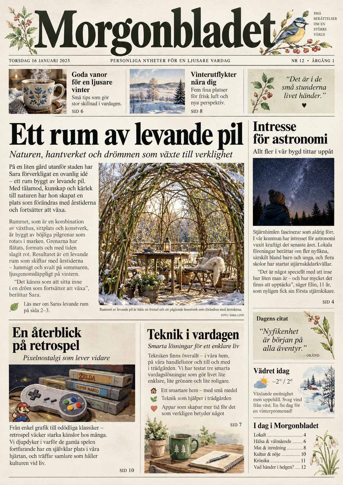

# Morgonbladet – produkt- och designkontrakt

**Beslutsdatum:** 2026-10-31.
**Reviderat designbeslut:** 2026-11-01.
**Ägare:** BigBrains produktägare.
**Status:** Fast A4-designmaster med separata innehållszoner beslutad; implementation och visuell acceptans återstår.
**Implementation:** N1 är ännu inte visuellt accepterad, mergad
eller deployad. Dokumentet ger ingen exekveringsauktorisering.

Detta är den centrala produktspecifikationen för Morgonbladet.
Vid framtida uppdrag ska denna fil läsas tillsammans med aktuell
`main`, `AGENTS.md`, tillämpliga regler och berörd kod.

## 1. Produktvision

Morgonbladet är en personlig morgontidning som sammanställs
för hushållets medlemmar och skrivs ut på A4.

- Varje person väljer sitt eget maximala sidantal: 1–3 sidor.
- Innehållet bygger på personens intressen och önskemål.
- Tidningen ska vara lugn, vacker, lättläst och källkritisk.
- Maxantalet sidor är en faktisk gräns för färdig PDF och utskrift.
- Tidningens visuella identitet är fast och konsekvent.
- Inga automatiska säsongs-, högtids- eller slumpdekorationer används.
- Endast innehållet, artikelbilderna, datumet och annan
  utgåvespecifik information varierar mellan utgåvor.
- Grafisk kvalitet uppnås genom godkända, återanvändbara
  designassets, inte genom daglig generering av dekorationer.

## 2. Vald designriktning – produktägarens beslut

**Klassisk morgontidning med varm, personlig akvarellkänsla.**

Den valda visuella referensen är den mer traditionella
Morgonbladet-framsidan, inte den mer magasinlika varianten.
Referensbilden valdes av produktägaren 2026-10-31.

### Visuell beskrivning av referensen

- Mycket stor, klassisk serif-vinjett med texten "Morgonbladet".
- Mörkgrön eller nästan svart typografi.
- Vackra, fasta botaniska akvarelldetaljer kring vinjetten,
  exempelvis kvistar, blommor och en liten fågel.
- En kompakt rad med datum, utgåva och korta notiser.
- Redaktionell spaltlayout med en tydligt dominerande huvudartikel.
- Huvudartikel med stor rubrik, ingress, längre text och stor bild.
- Mindre artiklar i olika storlekar runt huvudartikeln.
- Små sidospalter för korta, relevanta faktarutor eller notiser.
- Tunna avdelare, diskreta bildtexter och tydlig sidnumrering.
- Flera innehållsblock använder A4-ytan effektivt.
- En personlig, varm känsla utan att sidan blir plottrig.

Referensens förstasida visar bland annat en stor artikel om ett
rum av levande pil, en astronomispalt och mindre block om
retrospel och vardagsteknik. Dessa ämnen är exempel, inte
obligatoriskt innehåll i varje utgåva.

De påhittade nyhetstexterna, citaten, vädret, namnen, bilderna
och sidnumren i illustrationsreferensen är endast designexempel.
De ska inte behandlas som verkliga uppgifter eller källor.

### Versionshanterad bildreferens

Bilden är den av produktägaren valda visuella referensen, inte
en färdig utskriftsmall eller en produktionsasset. Bildens
illustrativa nyheter, datum, citat, väder och sidnummer är
fiktiva och får inte återanvändas som verifierat innehåll.
Den krämvita tonen ska skapas av pappret, inte genom att
skriva ut en heltäckande bakgrundsfärg.

Referensbilden används för konstnärlig riktning och är inte
den framtida designmastern. En ny, textfri A4-master med
separat zondefinition ska tas fram och godkännas.

## 3. Papper, sidbakgrund och färg

Primärt mål är naturvitt eller krämvitt A4-papper.

- Papprets egen färg skapar den varma grundtonen.
- Ingen heltäckande krämfärgad eller annan färgad sidbakgrund
  får skrivas ut.
- Utskriftsbakgrunden ska vara vit eller transparent.
- Brödtext har hög kontrast och trycks helst i svart.
- Rubriker, ingresser, ramar och andra redaktionella designelement får vara färgstarka när de stärker läsupplevelsen.
- Fotografier, målade illustrationer och dekorativa bilder får använda hela färgskalan när de bidrar till den visuella upplevelsen.
- Akvarellornament får vara stora, detaljrika och färgstarka när det gagnar gestaltningen och läsbarheten.
- Enkla kodritade SVG-motiv är inte standard för artikelillustrationer. Riktiga bilder med verifierade rättigheter prioriteras; SVG får användas för enklare grafiska detaljer.
- Bläckbesparingen gäller endast den heltäckande sidbakgrunden, inte artikelbilder, illustrationer, ornament eller andra redaktionella färgytor.
- Tidningen ska fungera även på vanligt vitt kopieringspapper.

Naturvitt papper är ett önskat materialval, inte ett krav på att
skrivaren eller PDF-generatorn ska simulera pappersfärgen.

## 4. Fast A4-designmaster och dynamiska innehållszoner

### 4.1 Designmaster

Morgonbladet använder en förhandsgodkänd, versionshanterad
A4-designmaster som grafiskt grundlager.

Designmastern får skapas med bildgenerering och innehålla
vinjetten, den fasta fågeln, botaniska akvarellkvistar,
grafiska avdelare och övriga permanenta designelement.

- Mastern representerar en exakt A4-sida: 210 × 297 mm.
- Pappersbakgrunden är vit eller transparent.
- Mastern innehåller inga dagsaktuella nyhetsrubriker,
  artikeltexter, artikelbilder, datum, källor eller sidnummer.
- Om tidningsnamnets grafiska vinjett ingår i masterbilden
  är den ett fast, godkänt varumärkeselement.
- Text- och bildytor i mastern är reserverade och lämnas tomma.
- Designmastern ska ha tillräcklig upplösning för tydlig utskrift.
- Masterbild, zondefinition och version hör alltid ihop.
- Nya utgåvor genererar inte nya designmasters.

En komplett sidbild får alltså användas som fast grafiskt
underlag, men inte som ett rasteriserat slutresultat där
nyhetsinnehållet har bakats in.

### 4.2 Dynamiskt innehållslager

BigBrain placerar utgåvans innehåll ovanpå designmastern
genom ett separat, deterministiskt innehållslager.

Det dynamiska lagret omfattar bland annat:

- Huvudrubriker och underrubriker.
- Ingresser och brödtext.
- Aktuella, relevanta artikelbilder.
- Bildtexter och erforderliga upphovsangivelser.
- Datum, källhänvisningar och sidnummer.
- Innehållsförteckning och fortsättningshänvisningar.

Rubriker och brödtext ska återges som riktig, skarp och
sökbar text i PDF, inte som pixlar inbyggda i en bild.
Färg och fotografier får användas fullt ut inom den
redaktionella designen.

### 4.3 Måttsatta innehållszoner

Varje godkänd designmaster ska ha en separat,
versionshanterad zondefinition.

För varje dynamisk zon ska följande kunna fastställas:

- Unikt zon-ID och innehållstyp.
- Position X och Y relativt A4-sidans koordinatsystem.
- Bredd och höjd i mm eller entydigt konverterbara enheter.
- Säkerhetsmarginal och eventuell inre utfyllnad.
- Typografi: typsnitt, teckenstorlek, radavstånd och justering.
- Högsta tillåtna antal faktiskt renderade textrader.
- Bildformat och tillåten beskärning när zonen innehåller bild.
- Hantering av tomt innehåll och text som inte ryms.

Zonernas exakta mått fastställs först när respektive
designmaster har granskats och godkänts. AI-genererade
visuella ytor betraktas inte automatiskt som exakta
koordinater; zonerna ska mätas, dokumenteras och testas.

### 4.4 Textpassning och redaktionell integritet

Textbudgeten bestäms av faktisk typografisk passning
inom zonens mått, inte enbart av antal tecken eller ord.

- Radräkning och höjd verifieras av renderingsmotorn.
- Text får aldrig klippas utan att systemet upptäcker det.
- För långt innehåll ska hanteras med ett kontrollerat,
  faktatroget utdrag eller placering i annan tillåten zon.
- Fortsättningshänvisningar får bara peka på en verklig
  fortsättning inom den aktuella utgåvan.
- Om innehållet inte ryms ska en godkänd reservmall
  väljas eller utgåvan stoppas för korrigering.
- Ingen text får ligga ovanpå fasta dekorativa element,
  annan text, bilder eller sidfoten.

Sammanfattningar får inte fabricera, förvanska eller utelämna
viktig sakinformation på ett vilseledande sätt.

### 4.5 Sidmallar och innehållsvariation

Ett litet antal fasta, testade mallar används för förstasida
och efterföljande sidor. Mallval får bero på innehållets
faktiska behov, exempelvis tillgång till relevant bild.

Alla mallar delar samma grafiska identitet.
Ingen daglig AI-generering av en ny sidlayout ingår.

Mallar och zondefinitioner måste tillsammans garantera
att den färdiga utgåvan håller sig inom användarens
maximala sidantal, 1–3 A4-sidor.

Både artiklar med bild och artiklar utan bild ska kunna
hanteras utan att felaktiga platshållarbilder används.

## 5. Personliga inställningar – framtida funktioner

Varje person ska kunna ange intressen och ett maximalt sidantal.

Det ska också gå att välja positiva eller "glada" nyheter,
antingen som ett övergripande önskemål eller för utvalda
nyheter eller ämnesområden.

Positivitetsval får aldrig innebära fabricering, obalanserad
faktapresentation eller att källkritiska krav åsidosätts.

Inställningar, personprofiler och automatiserad nyhetsinhämtning
är framtida uppgifter och inte redan levererade N1-funktioner.

## 6. Källkritik och redaktionell integritet

- Nyhetsartiklar ska ha spårbara och identifierbara källor.
- Källornas aktualitet, tillförlitlighet och rättigheter ska
  bedömas innan material används.
- Fakta ska skiljas från åsikter, prognoser och illustrationer.
- Påhittade citat, lokala händelser eller väderdata får aldrig
  presenteras som verkliga nyheter.
- Fiktivt demonstrationsinnehåll ska tydligt märkas som demo.
- Bilder ska ha lämplig proveniens och användningsrätt.
- Vid osäker källa eller verifiering utelämnas påståendet.

## 7. Fast grafisk identitet och bildrättigheter

Fågeln, kvistarna, blommorna och andra fasta ornament är
permanenta delar av Morgonbladets grafiska identitet.

- Dessa originalillustrationer får tas fram med bildgenerering.
- Produktägaren godkänner illustrationerna innan användning.
- Godkända bilder lagras som versionshanterade assets.
- Samma godkända design återanvänds mellan utgåvor.
- Inga dynamiska katter, årstidsdekorationer,
  högtidsvarianter eller slumpmässiga ornament genereras.
- Ändring av den fasta grafiska identiteten kräver
  ett separat designbeslut och ny verifiering.

Artikelbilder är däremot dynamiska och ska vara relevanta
för den faktiska artikeln. Källa, upphovsperson, licens och
eventuella villkor för beskärning eller bearbetning ska
kontrolleras och kunna redovisas.

Bilder utan verifierad användningsrätt får inte användas.
Vid avsaknad av lämplig bild ska en godkänd textbaserad
layout kunna användas.

Dekorativa originalillustrationer får inte förväxlas med
dokumentära bilder från verkliga nyhetshändelser.

## 8. N1 – teknik, verifiering och kvarstående acceptans

N1 är fortsatt en statisk Web-only-prototyp med tydligt
märkt demoinnehåll. Verklig nyhetsinhämtning ingår inte.

2026-10-31 verifierades äldre PDF-utskrifter med exakt
1, 2 och 3 A4-sidor. Dessa prov avsåg den dåvarande
HTML/CSS-layouten och är historisk teknisk evidens,
inte ett godkännande av den nya arkitekturen.

Under 2026-11-01 har den vidareutvecklade redaktionella
prototypen fortfarande visat överlappning och innehåll
som spiller mellan sidor. Detta är inte löst genom
detta dokumentationsbeslut.

Befintlig implementation för granskning finns i:
[PR #22](https://github.com/T-bear/BigBrain/pull/22).

Den implementationen bygger inte på den nu beslutade
designmaster-arkitekturen och måste omprövas innan den
kan bli en godkänd leveranskandidat.

### Kvarvarande acceptanskriterier

- Fast grafisk identitet och designmaster godkänns av ägaren.
- Masterbild och motsvarande zondefinition är versionsbundna.
- Variabla texter och artikelbilder placeras i egna lager.
- Textpassning verifieras med faktisk renderad höjd.
- Färdig PDF innehåller skarp och sökbar artikeltext.
- Bildrättigheter, källor och bildtexter är kontrollerade.
- Inga ofrivilliga överlappningar, avklipp eller extrasidor.
- Exakt 1, 2 och 3 A4-sidor verifieras separat.
- Ingen heltäckande färgad pappersbakgrund skrivs ut.
- Mobil webbläsare och dator kontrolleras separat.
- Installerad BigBrain-PWA får separat manuell acceptans.
- Produktägaren godkänner den slutliga visuella designen.

Det nya designbeslutet är inte implementerat eller
verifierat genom denna dokumentationsändring.

Grön CI, publicerad PR och historiska PDF-prov innebär
inte automatiskt visuell acceptans, mergegodkännande
eller deploymenttillstånd.

## 9. Etapper och avgränsning

- **N1:** Statisk tidningsprototyp, design och A4-utskrift.
- **N2:** Verklig, källkritisk nyhetsinhämtning. Separat uppdrag.
- **N3:** Individanpassning, intresseval och positivt nyhetsfilter.
  Separat uppdrag.

Inget i detta dokument auktoriserar nya API:er, databaser,
kostnader, nya tjänster, merge eller deployment.

## 10. Ändringsprincip

Ändrade produktbeslut dokumenteras här eller i senare
auktoritativt modulkontrakt med tydlig hänvisning.

Särskilj alltid:
- beslutade krav,
- föreslagna lösningar,
- implementerad men ej accepterad kod,
- verifierad teknik,
- manuellt accepterad design,
- och faktiskt deployad funktion.

Projektets permanenta arbets- och säkerhetsregler gäller
oförändrat.
